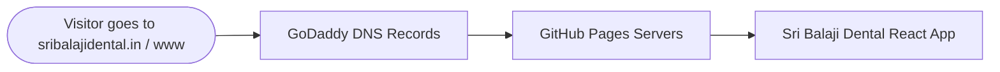

# Deploying Sri Balaji Dental to GitHub Pages with GoDaddy Domain

**Domain:** `sribalajidental.in`  
**GitHub Repository:** `https://github.com/adilxdesigns/sri-balaji-dental`  
**Hosting Platform:** GitHub Pages (Automated via GitHub Actions)

---

## Architecture Flow



---

## Summary of Prepared Files (Already Done For You)

1. **`public/CNAME`**: Created with `sribalajidental.in` so GitHub Pages permanently retains your custom domain across deployments.
2. **`vite.config.js`**: Updated `base: '/'` to ensure all asset paths and CSS/JS scripts resolve at the root of `sribalajidental.in`.
3. **`.github/workflows/deploy.yml`**: Configured GitHub Actions to automatically run `npm run build` and deploy to GitHub Pages on every push to the `main` branch.

---

## Step 1: Push Your Code to GitHub

Open your terminal or command prompt in your project root and run:

```bash
git add .
git commit -m "Configure GitHub Pages deployment and custom domain CNAME"
git push origin main
```

---

## Step 2: Enable GitHub Pages in Your Repository Settings

1. Go to your repository on GitHub:  
   👉 **[https://github.com/adilxdesigns/sri-balaji-dental/settings/pages](https://github.com/adilxdesigns/sri-balaji-dental/settings/pages)**
2. Under **Build and deployment**:
   - **Source:** Select **`GitHub Actions`** (from the dropdown menu).
3. Under **Custom domain**:
   - Type: `sribalajidental.in`
   - Click **Save**.
   - *(GitHub will automatically check for the CNAME record).*
4. Once DNS is configured in GoDaddy (Step 3), return here and tick:
   - ☑ **Enforce HTTPS** (secures the site with a free SSL certificate).

---

## Step 3: Configure GoDaddy DNS Records (Exact Settings)

1. Log into your **[GoDaddy Account](https://account.godaddy.com/)**.
2. Go to **My Products** → click **DNS** (or **Manage DNS**) next to **`sribalajidental.in`**.

### A. Remove Conflicting Default GoDaddy Records
> [!IMPORTANT]
> Remove any default "Parked" records, otherwise visitors will see GoDaddy's holding page instead of your clinic website.
- If there is an **A record** with Name `@` pointing to `Parked` (or an IP like `34.102.136.180`), click the **Trash icon** to delete it.
- If there is a **CNAME record** with Name `www` pointing to `@` or `_domainconnect`, delete or edit it.

### B. Add the 4 GitHub Pages A Records (Apex Domain)
Click **Add New Record** and add these 4 **A** records one by one:

| Record Type | Name | Value (Points to) | TTL |
| :--- | :--- | :--- | :--- |
| **A** | `@` | `185.199.108.153` | 1/2 Hour (or default) |
| **A** | `@` | `185.199.109.153` | 1/2 Hour (or default) |
| **A** | `@` | `185.199.110.153` | 1/2 Hour (or default) |
| **A** | `@` | `185.199.111.153` | 1/2 Hour (or default) |

### C. Add the CNAME Record for WWW Subdomain
Click **Add New Record** and add the CNAME record:

| Record Type | Name | Value (Points to) | TTL |
| :--- | :--- | :--- | :--- |
| **CNAME** | `www` | `adilxdesigns.github.io` | 1/2 Hour (or default) |

*(Note: Do NOT include `https://` in the CNAME value. Just write `adilxdesigns.github.io`)*

Click **Save** / **Save All Records**.

---

## Step 4: Verify Deployment & Enable HTTPS

1. In GitHub, go to the **Actions** tab:  
   👉 **[https://github.com/adilxdesigns/sri-balaji-dental/actions](https://github.com/adilxdesigns/sri-balaji-dental/actions)**
2. You will see the **Deploy to GitHub Pages** workflow run and turn green (takes ~60 seconds).
3. Back in **Settings → Pages**:
   - GitHub will show: *"DNS check successful"*.
   - Ensure the checkbox **"Enforce HTTPS"** is checked (it may take 5–15 minutes for Let's Encrypt TLS certificate provisioning).

---

## Verification & Testing Checklist

- [ ] Check DNS propagation globally at: [DNSChecker for sribalajidental.in](https://dnschecker.org/#A/sribalajidental.in)
- [ ] Open `https://sribalajidental.in` in an incognito window.
- [ ] Open `https://www.sribalajidental.in` and confirm it forwards to the site.
- [ ] Test the WhatsApp quick button and Phone Call button on a mobile phone.
- [ ] Verify that all gallery photos (Dental Implants in the updated order) display crisp and clean.
